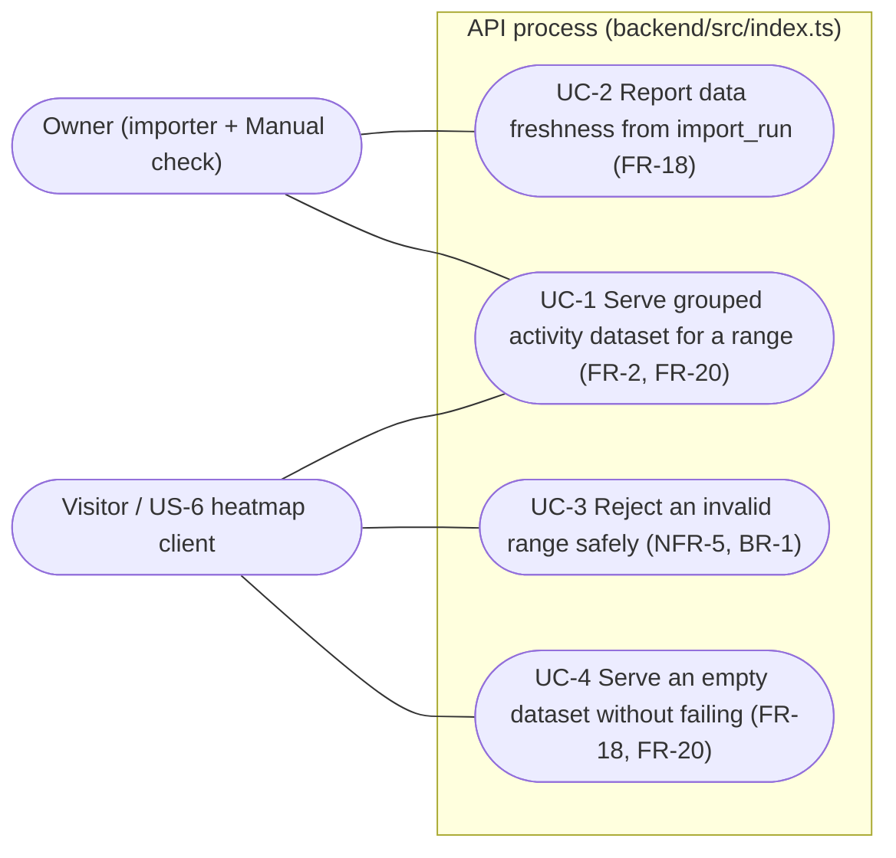
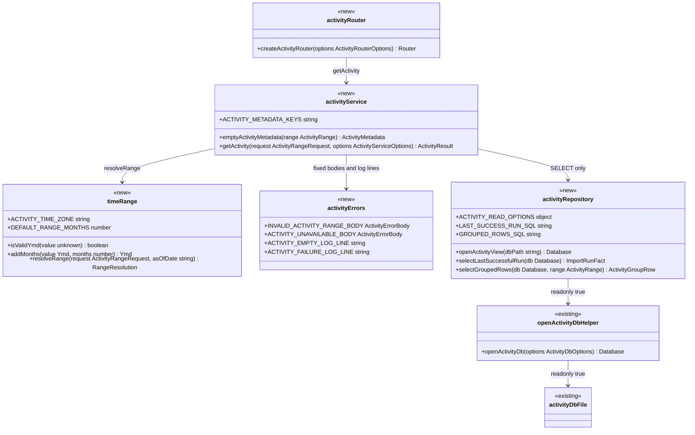
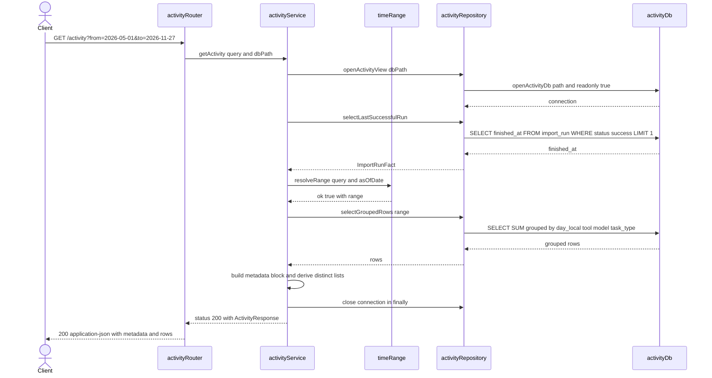
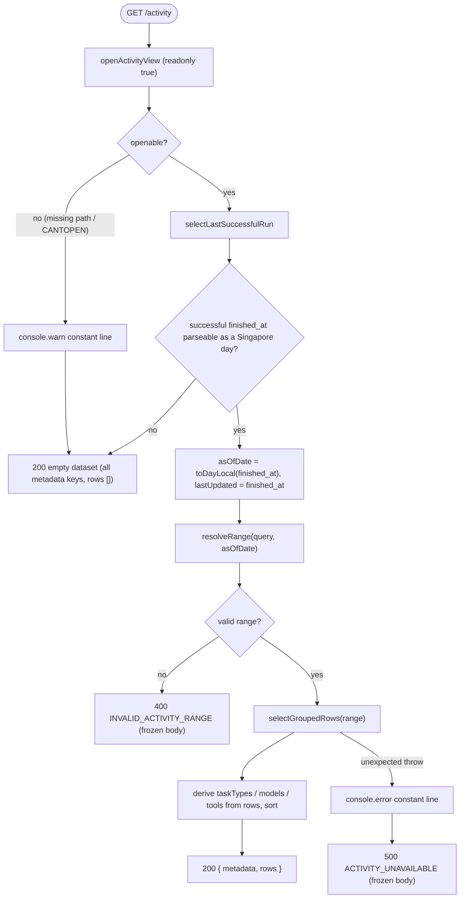
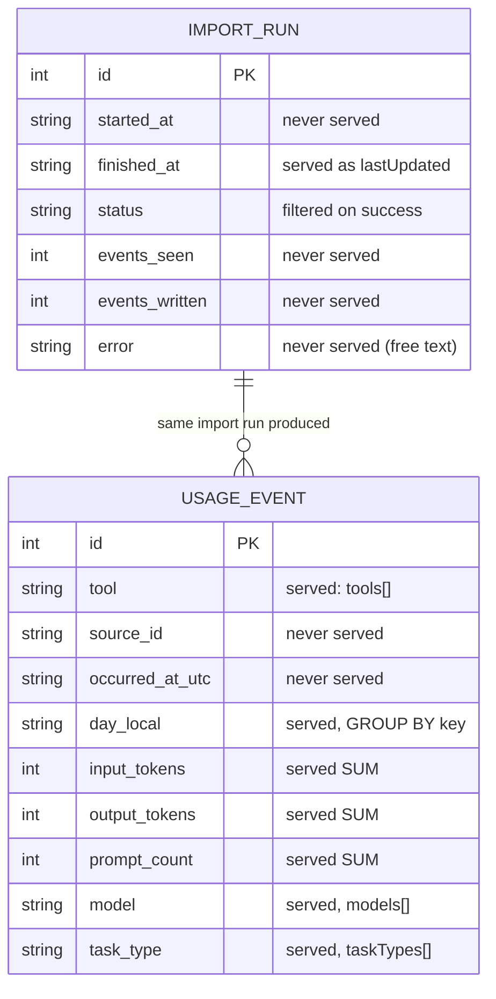

# Design: US-4 Read-only GET /activity API

Status: draft

## Story and traceability

Story: US-4 (`docs/product/stories/US-4-activity-api.md`, Status: approved, Type: backend, UX needed: no).
Component: the backend **API process** — the express application composed in `backend/src/index.ts`.
No CMP ID can be cited: `docs/architecture/architecture.md`, the requirements file and the ADR files are
**not tracked in this repository** (approved backlog Assumptions, rows "Sprint-1/Sprint-2 planning" of the
change log), so there is no Components table to link. This story adds **modules inside the existing API
component**; it adds no component, no data store, no inter-component dependency and no deployment change
(see Deviations from architecture). The same precedent was followed by
`docs/specs/us-23-normalise-opencode-model-descriptor.md`.

| Cited by the story | What it constrains here | Source of the wording |
|---|---|---|
| FR-2 | Serve the grouped daily dataset for a range | backlog Requirements-coverage + Assumptions |
| FR-18 | `lastUpdated` from the last successful `import_run`; empty states | story AC-1/AC-3 |
| FR-20 | The metadata block (time zone, as-of date, last updated, task types, models, tools) | story AC-1, backlog Assumptions |
| BR-1 | No prompt/response content ever leaves the server | AC-4, AC-7 |
| BR-4 | `Asia/Singapore` reported literally in the metadata | AC-1 |
| BR-5 | Model names as stored (US-23-normalised) | AC-1 Notes |
| NFR-2 | Range responses fast enough for the 300 ms p95 planning stand-in | AC-8 + story Notes |
| NFR-5 | No driver text, path or source value in body, logs or stdout | AC-4, AC-7 |
| ADR-1 | Thin API over a pre-aggregated read model (no browser access to tool DBs) | backlog Assumptions |
| ADR-3 | One `activity.db` written only by the importer; the API reads it | story Notes, AC-5 |
| ADR-5 | Contract `GET {NEXT_PUBLIC_API_URL}/activity?from=&to=` → metadata + grouped rows | backlog Assumptions |

Dependencies US-2 (`backend/src/import/activityDb.ts`, merged PR #22) and US-23
(`backend/src/import/modelNormalise.ts`, merged PR #28) are on `origin/main`; both are reused, not modified.

## Analysis

**Domain concepts and responsibilities**

- *Read model*: `activity.db` already stores the pre-aggregated grain required by the contract. The API's
  job is projection + presentation only — it must not re-derive task types, models or day boundaries.
- *Served range*: an inclusive pair of `Asia/Singapore` calendar days. It is **resolved** (not merely
  parsed): explicit parameters win, absent ones fall back to the default 12-month window anchored on the
  data's as-of date. The applied range is echoed in the metadata (AC-6).
- *As-of date / last updated*: freshness facts of the **data**, therefore derived from `import_run`
  (most recent successful run), never from the wall clock — so repeat responses are byte-stable
  (story Notes, "exact derivation is the tech lead's call").
- *Fixed shapes*: the 400 body and the operational log line are constants, which is the structural
  guarantee that an invalid value can never be echoed (NFR-5, AC-4).

**Responsibilities deliberately NOT taken here**

- Filtering by model/tool/task type (US-10 filters client-side over the full dataset), filling empty days
  (FR-3, US-6), caching/compression/pagination (story Out of scope), method lock-down/CORS/helmet/rate
  limit/trust proxy (US-5), and any schema creation or migration (ADR-3: only the importer owns the schema).

**Existing code to reuse**

| Reused | How |
|---|---|
| `openActivityDb({ path, readonly: true })` — `backend/src/import/activityDb.ts` | The single DB-open point (AC-5). Its `path > env ACTIVITY_DB_PATH > throw` precedence is kept; no default is invented in the API layer. |
| `ACTIVITY_SCHEMA_DDL`, `initActivitySchema` | **Test/fixture side only** (`better-sqlite3` scratch DBs). Production API code never calls them. |
| `upsertUsageEvents` | Test/fixture seeding only, so seeded rows are written through the importer's real write path. |
| `DEFAULT_TIMEZONE = 'Asia/Singapore'` and `toDayLocal(instant, timeZone)` — `backend/src/import/dayLocal.ts` | `asOfDate` = the Singapore calendar day of the successful run's `finished_at` (no new date dependency; Intl already proven in US-2/US-3). |
| `backend/tests/fixtures/opencodeDb.ts` (`writeOpencodeFixture`, `DEFAULT_FIXTURE_MARKER`) | The strongest NFR-5 proof: import real fixture rows (marker-bearing prompt text is dropped at import), then serve them. |
| Test conventions from `backend/tests/runImport.test.ts` | `fs.mkdtempSync` scratch dir, `freshActivityDbPath()`, `console` spies, raw-byte scans. |

**Impact analysis (files and modules affected)**

| File | Change |
|---|---|
| `backend/src/activity/timeRange.ts`, `activityErrors.ts`, `activityRepository.ts`, `activityService.ts`, `activityRouter.ts` | **new** — the read-model query layer, the fixed error shapes and the route |
| `backend/src/index.ts` | **additive only**: one `import` + one `app.use('/activity', activityRouter)` after the three legacy mounts |
| `backend/tests/fixtures/activitySeed.ts` | **new** — deterministic `activity.db` seeder (generated values only) |
| `backend/tests/activityTimeRange.test.ts`, `activityRepository.test.ts`, `activityService.test.ts`, `activityApi.test.ts`, `activityReadOnly.test.ts`, `activityMount.test.ts`, `activityApi.timing.test.ts` | **new** |
| `backend/jest.config.js` | additive: `collectCoverageFrom` + two coverage thresholds for `src/activity/**` |
| Untouched (hard constraint) | `backend/src/db.ts`, `backend/src/routes/{chat,entity,staticData}.ts`, `backend/src/import/**`, every pre-existing test file, `package.json` dependencies |

**Coupling and cohesion notes**

- One direction of dependency: `activityRouter → activityService → activityRepository → timeRange`, and
  the only outward edge is `activityRepository → import/activityDb` (the existing open helper). The
  service returns plain data (`ActivityResult`), so it is testable without express, and the router contains
  no SQL or date logic.
- The API layer never imports `backend/src/db.ts` (the legacy portfolio DB) and never uses `__dirname` for
  DB location — enforced by a structural test, not by convention (story Notes forbid the legacy pattern).
- The legacy routes stay independent of the new mount; the only shared object is the express `app`.
  Ordering the new mount last means the legacy behaviour is untouched.

**Risks**

| Risk | Handling |
|---|---|
| A read-only open of a WAL DB can fail with `SQLITE_READONLY_CANTINIT` when a hot `-wal` exists but no `-shm` (owner's DB mid-import) | Tests open the read-only view while an *already-open* writer holds a transaction (the normal state — `runImport` checkpoints and closes, and the last connection close removes `-wal`/`-shm`, probe-verified). Recorded as an open question for US-13's volume/run ordering. |
| Operational failure could turn into a silent empty heatmap | Chosen deliberately for AC-3 (never 500, missing DB = launch state, logs go back ~1 month). Mitigated by a constant `console.warn` line and by US-11's offline/empty states. Listed under Risks in the spec. |
| AC-8's 20-sample p95 is statistically weak and a max-based gate is flaky | p95 over 100 measured samples after warm-up, plus "all 20 AC-8 requests returned 200" — probe measured 0.27 ms per grouped query, ~100× headroom under 300 ms. |
| `models` may contain raw JSON if US-23 regressed | The metadata test **asserts 0 `models` values contain `{` or `}`** and fails loudly: that is a US-23 defect to report, not to paper over (story Notes). |
| US-5 mounts hardening middleware over the same router | Router is a factory (`createActivityRouter(options)`), so US-5 can wrap or re-mount it without editing this code. |

## Use case

| Field | Content |
|---|---|
| Actor | Visitor (the public portfolio home page / US-6 heatmap client); Owner (runs the importer and the Manual (user) check) |
| Goal | Get the complete grouped activity dataset plus freshness metadata for a date range, over one public read-only endpoint, without the browser touching any tool DB |
| Preconditions | `activity.db` exists at `ACTIVITY_DB_PATH` (or the path option) and its schema was created by the importer; the API process is running with `backend/src/index.ts` |
| Main flow | 1. Client sends `GET /activity?from=&to=`. 2. Router hands the raw query to the service. 3. Service opens the DB read-only via `openActivityDb({path, readonly: true})`. 4. Service reads the newest `status='success'` `import_run` → `lastUpdated`, derives `asOfDate` = Singapore day of `finished_at`. 5. Service resolves the inclusive range (explicit params, else `to = asOfDate`, `from = asOfDate − 12 months`). 6. Service runs the grouped `SELECT` for the range. 7. Service derives `taskTypes`, `models`, `tools` from the served rows and sorts them. 8. Service closes the connection and returns `200` + `{metadata, rows}`; the router serialises it as `application/json`. |
| Alternative flows | A. Invalid/`from > to`/array/non-calendar date → `400` with the frozen `INVALID_ACTIVITY_RANGE` body, no query issued. B. Range with no usage, or no successful import yet, or DB file/`ACTIVITY_DB_PATH` missing/unopenable → `200` with the full metadata block (nulls/`[]`) and `rows: []`, plus one constant `console.warn` line. C. Unexpected error → `500` with the frozen `ACTIVITY_UNAVAILABLE` body and a constant `console.error` line; nothing is interpolated. D. A writer holds a transaction → the reader sees the last committed snapshot and returns `200`. |
| Postconditions | `activity.db` is byte-identical (no writes, no schema change, no WAL growth); the response is stable across repeats while no import runs |
| Acceptance criteria | AC-1 … AC-9 (AC-9 Manual (user)) |



## Design

**Components and responsibilities (all inside the API component)**

| Module | Responsibility | Must never |
|---|---|---|
| `src/activity/timeRange.ts` | Pure date logic: strict `YYYY-MM-DD` validation, calendar-month arithmetic with month-end clamping, range resolution/echo. No DB, no express, no I/O. | read the clock, touch the DB, import express |
| `src/activity/activityErrors.ts` | The frozen public error bodies and the constant log lines. | interpolate any value |
| `src/activity/activityRepository.ts` | Own the only DB connection in the API: read-only open through `openActivityDb`, three `SELECT` statements, typed results. | `INSERT`/`UPDATE`/`DELETE`/DDL/`PRAGMA`, call `initActivitySchema`, use `__dirname` |
| `src/activity/activityService.ts` | Orchestration + shape building: freshness, range resolution, metadata lists, empty/500 mapping. No express types. | log an interpolated message |
| `src/activity/activityRouter.ts` | Express adapter only: `GET /` on the mounted router, status codes, JSON send. | contain SQL or date rules |

**Interfaces (name, inputs and types, output, errors)**

```ts
/* backend/src/activity/timeRange.ts — pure, imports nothing */
export const ACTIVITY_TIME_ZONE: 'Asia/Singapore';       // BR-4 literal, re-export of dayLocal.DEFAULT_TIMEZONE
export const DEFAULT_RANGE_MONTHS: 12;                   // AC-6
export type Ymd = string;                                // a VALIDATED 'YYYY-MM-DD' calendar date

export function isValidYmd(value: unknown): value is Ymd;
// true iff typeof value === 'string' and value matches /^\d{4}-\d{2}-\d{2}$/ and the
// Date.UTC(y, m-1, d) round-trip reproduces y/m/d exactly (so 2026-02-30, 2026-13-01,
// '2026-1-5', '', ' 2026-11-05', '2026-11-05T00:00:00Z' and non-strings are all false).

export function addMonths(value: Ymd, months: number): Ymd;
// Calendar arithmetic on (y, m, d); d is clamped to the last day of the target month.
// Throws RangeError when !isValidYmd(value) or !Number.isInteger(months).

export interface ActivityRange { readonly from: Ymd; readonly to: Ymd }
export interface ActivityRangeRequest { readonly from?: unknown; readonly to?: unknown }
export type RangeResolution =
  | { readonly ok: true; readonly range: ActivityRange }
  | { readonly ok: false; readonly code: 'INVALID_ACTIVITY_RANGE' };

export function resolveRange(request: ActivityRangeRequest, asOfDate: Ymd | null): RangeResolution;
// Blank rule (backlog contract is literally "?from=&to="): a value that is absent, or a
// string whose trim() is empty, counts as ABSENT and takes its default. Any other value
// (including an array from ?from=a&from=b, a number, or an invalid date) is INVALID.
// to  := explicit to  ?? asOfDate          from := explicit from ?? addMonths(to, -12)
// from > to  =>  { ok: false, code: 'INVALID_ACTIVITY_RANGE' }
// asOfDate === null and no explicit pair usable => { ok: false, code: 'INVALID_ACTIVITY_RANGE' }
//   The **service** supplies asOfDate as: Singapore day of the newest successful
//   import_run.finished_at, else MAX(day_local) from usage_event (a run interrupted between
//   the committed upsert and the success UPDATE still leaves rows), else null. Only the
//   all-null case reaches this branch, and there the service answers the empty dataset
//   (200, from/to null, rows []) without querying — AC-3 flow B. resolveRange itself never
//   touches the database and never returns a default of its own invention.

/* backend/src/activity/activityErrors.ts */
export interface ActivityErrorBody { readonly error: { readonly code: string; readonly message: string } }
export const INVALID_ACTIVITY_RANGE_BODY: ActivityErrorBody; // frozen { error: { code: 'INVALID_ACTIVITY_RANGE',
  // message: 'from and to must be YYYY-MM-DD calendar dates and from must not be later than to' } }
export const ACTIVITY_UNAVAILABLE_BODY: ActivityErrorBody;   // frozen { error: { code: 'ACTIVITY_UNAVAILABLE',
  // message: 'the activity data is temporarily unavailable' } }
export const ACTIVITY_EMPTY_LOG_LINE: string;  // 'activity: read model unavailable, serving empty dataset'
export const ACTIVITY_FAILURE_LOG_LINE: string; // 'activity: read model failed'
export function errorBody(body: ActivityErrorBody): ActivityErrorBody; // returns the same frozen constant

/* backend/src/activity/activityRepository.ts */
import type Database from 'better-sqlite3';
export const ACTIVITY_READ_OPTIONS: { readonly readonly: true };   // AC-5, the single open-mode constant
export const LAST_SUCCESS_RUN_SQL: string;                          // exported for the SELECT-only scan test
export const GROUPED_ROWS_SQL: string;
export interface ImportRunFact { readonly finished_at: string | null }
export interface ActivityGroupRow {
  readonly day_local: string; readonly tool: string; readonly model: string; readonly task_type: string;
  readonly input_tokens: number; readonly output_tokens: number; readonly prompt_count: number;
}
export function openActivityView(dbPath?: string): Database.Database;
// openActivityDb({ path: dbPath, ...ACTIVITY_READ_OPTIONS }) — path/precedence/env handling stays
// in the reused helper; throws what the helper throws (missing config, SQLITE_CANTOPEN, ...),
// which the SERVICE catches. This function itself contains no try/catch and no PRAGMA.
export function selectLastSuccessfulRun(db: Database.Database): ImportRunFact | null;
export function selectGroupedRows(db: Database.Database, range: ActivityRange): ActivityGroupRow[];

/* backend/src/activity/activityService.ts */
export interface ActivityMetadata {
  readonly timeZone: string;                     // always 'Asia/Singapore' (AC-1)
  readonly asOfDate: string | null;              // Singapore day of the last successful finished_at
  readonly lastUpdated: string | null;           // that finished_at verbatim (FR-18)
  readonly from: string | null;                  // applied range echo (AC-6)
  readonly to: string | null;                    // applied range echo (AC-6)
  readonly taskTypes: string[]; readonly models: string[]; readonly tools: string[];
}
export interface ActivityResponse { readonly metadata: ActivityMetadata; readonly rows: ActivityGroupRow[] }
export type ActivityResult =
  | { readonly status: 200; readonly body: ActivityResponse }
  | { readonly status: 400; readonly body: ActivityErrorBody }
  | { readonly status: 500; readonly body: ActivityErrorBody };
export interface ActivityServiceOptions { readonly dbPath?: string }
export const ACTIVITY_TOP_LEVEL_KEYS: readonly string[];   // ['metadata', 'rows']
export const ACTIVITY_METADATA_KEYS: readonly string[];    // ['timeZone','asOfDate','lastUpdated','from','to','taskTypes','models','tools']
export const ACTIVITY_ROW_KEYS: readonly string[];         // the seven row columns
export function emptyActivityMetadata(range?: ActivityRange): ActivityMetadata; // all keys, nulls/[]
export function getActivity(request: ActivityRangeRequest, options?: ActivityServiceOptions): ActivityResult;
// never throws; console.warn/error receive the constant lines only

/* backend/src/activity/activityRouter.ts */
import type { Router } from 'express';
export interface ActivityRouterOptions { readonly dbPath?: string }
export function createActivityRouter(options?: ActivityRouterOptions): Router;  // router.get('/', ...)
export default /* activityRouter */ Router;   // createActivityRouter() -> env ACTIVITY_DB_PATH at request time
```

**SQL (the only statements the API issues)**

```sql
-- LAST_SUCCESS_RUN_SQL: newest successful run (import_run is tiny: one row per day)
SELECT finished_at FROM import_run
 WHERE status = 'success' AND finished_at IS NOT NULL
 ORDER BY finished_at DESC, id DESC
 LIMIT 1;

-- GROUPED_ROWS_SQL: the contract rows, inclusive range, deterministic order
SELECT day_local, tool, model, task_type,
       SUM(input_tokens) AS input_tokens,
       SUM(output_tokens) AS output_tokens,
       SUM(prompt_count)  AS prompt_count
  FROM usage_event
 WHERE day_local BETWEEN ? AND ?
 GROUP BY day_local, tool, model, task_type
 ORDER BY day_local, tool, model, task_type;
```

`day_local` is `TEXT` in ISO form, so `BETWEEN` is an exact lexicographic = calendar comparison; the
existing `idx_usage_event_day_local` serves the range scan and the three metadata lists are derived
in-process from the served rows (`[...new Set(rows.map(...))].sort()`), which is cheaper than three more
queries and structurally guarantees "distinct values **present in the served range**" (AC-1).

**Connection lifecycle** — open per request, close in `finally` (probe: ~0.02 ms per read-only open).
Alternatives considered in the Patterns table. Consequence: no shared mutable state, the API can never
hold a WAL read lock that starves the importer's checkpoint, and it always sees the last committed import.

## Patterns

| Pattern | Problem it solves here | Where applied | Alternatives considered | Consequences |
|---|---|---|---|---|
| Read model (materialised view read through a thin API) | ADR-1/ADR-3: the browser must never reach tool DBs and the request must stay cheap | `activityRepository` reads only what the importer already aggregated | Compute per request from raw tool DBs (rejected: breaks ADR-1/BR-1, blows NFR-2); a second replicated DB (rejected: new data store = architect's call) | The API's correctness is exactly the importer's aggregation; empty days are absent by design and the client fills them (FR-3) |
| Layered ports & adapters (dependency injection by options object) | SQL/date rules must be testable without express, and tests must point at a scratch DB | `RouterOptions.dbPath → ServiceOptions.dbPath → RepositoryOpenOptions.path → openActivityDb` | Import a module-level singleton DB handle (rejected: untestable, and `__dirname`-style location creep the story forbids) | One test seam (`dbPath`) serves every test; production config is `ACTIVITY_DB_PATH` only |
| Factory (creation of the router) | Tests need a router bound to a scratch DB; US-5 needs to re-mount the same router under hardening middleware | `createActivityRouter(options)`, default export unbound (env-driven) | Exporting a configured router constant only (rejected: no per-test binding); mounting middleware in `index.ts` per test (rejected: `index.ts` calls `listen` and imports the legacy DB) | `index.ts` keeps a one-line mount; US-5 can wrap without editing US-4 files |
| Null Object / total response | AC-3: "never a 500 and never a missing metadata key" | `emptyActivityMetadata()` — every key exists with `null`/`[]`; missing or unopenable DB and unparseable `finished_at` all route to it | Throw on missing DB (rejected: 500 breaks AC-3 at first launch, before any import has run); invent a wall-clock date (rejected: story Notes derive freshness from `import_run`, and responses must be stable) | The heatmap always has a parseable payload; the empty case is observable only in `lastUpdated === null` and the constant warn line |
| Constant (frozen) error bodies and log lines | AC-4/AC-7/NFR-5: no driver text, path or echoed value may appear anywhere | `activityErrors.ts`; the handler never interpolates `req.query` | Per-field detail messages (`'from "'+v+'" is invalid'` — rejected: echoes the client value, exactly what AC-4 forbids); exceptions + express error middleware (rejected: default handler leaks stack/driver text) | 400 is one byte-string for every invalid input (a `fields` hint would need its own NFR-5 proof, and AC-4 pins "a constant code and message"); debugging shifts to status code + the numeric check in AC-9 |
| Result (discriminated union) instead of exceptions for control flow | Validation and empty-data paths must not throw across the router boundary | `RangeResolution`, `ActivityResult` | `throw new ValidationError()` caught in the router (rejected: two ways to say the same thing, and a thrown driver error could be mistaken for a validation error) | Exhaustive `switch (result.status)` in the router; a missing case is a compile error under `strict` |
| Structural (source-scan) test | AC-5's "only SELECT, never creates/migrates/writes" and the story's "no `__dirname`" are properties of the code, not of one run | `activityReadOnly.test.ts`, `activityMount.test.ts` (the repo already uses this pattern for `console.*` in US-23) | Runtime-only proof (insufficient: a stray `initActivitySchema` would never fire in the happy path) | Refactors that add a write or a legacy import fail CI; scan patterns must be written case-insensitively against `src` string literals and must tolerate SQL keywords inside comments |
| No further pattern | — | The service is a single linear read pipeline; an Observer/cache/unit-of-work would be ceremony (no state change, caching is US-11's/US-5's scope) | — | Simple function per request path |

## Diagrams









The `IMPORT_RUN ||--o{ USAGE_EVENT` relation is *logical only*: `usage_event` has no `import_run_id`
column (schema owned by US-2, unchanged here), so the ER diagram documents which columns the read model
touches, not a new constraint.

## Data model

**Schema delta: none.** The API reads the US-2 schema exactly as merged
(`docs/product/stories/US-2-*`, `ACTIVITY_SCHEMA_DDL` in `backend/src/import/activityDb.ts`); it creates
nothing, migrates nothing and writes nothing (AC-5). Columns consumed:

| Table | Column | Type | Used for | Notes |
|---|---|---|---|---|
| `usage_event` | `day_local` | TEXT `YYYY-MM-DD`, `NOT NULL`, GLOB-checked | range filter + group key | `idx_usage_event_day_local` serves `BETWEEN` |
| `usage_event` | `tool`, `model`, `task_type` | TEXT `NOT NULL` | group keys, metadata lists | `model` values are US-23-normalised; a `{`/`}` value is a US-23 defect → the metadata test fails on purpose |
| `usage_event` | `input_tokens`, `output_tokens`, `prompt_count` | INTEGER `NOT NULL DEFAULT 0`, `>= 0` | `SUM(...)` | served as JSON numbers |
| `import_run` | `status`, `finished_at` | TEXT `NOT NULL` / TEXT | freshness block | filtered on `status='success'`, `finished_at IS NOT NULL`, newest first (`idx_import_run_status_started` is `(status, started_at)`; no new index — the table holds one row per day) |
| `import_run` | `error`, `events_seen`, `events_written`, `started_at`, `id`, `source_id`, `occurred_at_utc` | — | never served | free-text-bearing / internal columns; AC-7's key allow-list proves absence |

Migration notes: none required. A covering index
`(day_local, tool, model, task_type, input_tokens, output_tokens, prompt_count)` was considered and
**rejected for now**: at 620 grouped rows the measured query is 0.27 ms against a 300 ms budget, and
touching `ACTIVITY_SCHEMA_DDL` would edit US-2/US-23 merged code plus its allow-list test. Revisit if a
real 12-month range exceeds ~50k `usage_event` rows and AC-8's p95 loses its headroom (spec Risks).

## Error handling and edge cases

| Case | Behaviour (design) | AC |
|---|---|---|
| `from`/`to` missing entirely | default range `to = asOfDate`, `from = addMonths(to, -12)`, echoed in metadata | AC-1, AC-6 |
| `?from=&to=` (empty strings, the contract form US-6 sends) | each empty value counts as absent → same default range (never 400) | AC-1 |
| `from` valid, `to` absent | `to = asOfDate` (and `from` as given) | design decision, unit-tested |
| `to` valid, `from` absent | `from = addMonths(to, -12)` — keeps the 12-month width relative to a past `to` (US-19-friendly) | design decision, unit-tested |
| Malformed date (`2026-1-5`, `2026-02-30`, `2026-13-01`, `20260101`, trailing text) | `400` frozen body | AC-4 |
| Array value `?from=a&from=b`, non-string | `400` frozen body (no `String(array)` coercion) | AC-4 |
| `from > to` | `400` frozen body, no query | AC-4 |
| Unknown extra params (`?model=x`) | ignored (server-side filtering is out of scope, US-10 filters client-side) | design decision |
| Range with no usage rows | `200`, metadata complete, `rows: []`, `from`/`to` echo the requested range | AC-3 |
| `activity.db` present but no successful `import_run` | `asOfDate`/`lastUpdated` = `null`; if rows exist anyway (a run interrupted between the upsert commit and the success UPDATE), `asOfDate = MAX(day_local)` **inside the default-range path**, `lastUpdated` stays `null`; if not even that exists → `200`, `from`/`to` = `null`, `rows: []`, no query | AC-3 |
| `finished_at` unparseable by `toDayLocal` | treated as "no successful run" (`asOfDate`/`lastUpdated` `null`) + constant warn line — never a 500 | AC-3 |
| `ACTIVITY_DB_PATH` unset / DB file missing / open throws | `200` empty dataset + one constant `console.warn` line per request | AC-3 |
| Query throws (SQLITE_BUSY, corrupt file) | `500` frozen `ACTIVITY_UNAVAILABLE` + one constant `console.error` line; no driver message ever reaches the body | design decision for NFR-5 |
| Writer holds an open transaction | read-only reader sees the last committed snapshot, `200` (WAL readers do not block on writers) | AC-5 |
| Repeated identical requests | byte-identical body (no clock reads) — asserted in the contract test | AC-1, AC-6 |

## Security and privacy

- Read-only by construction: `readonly: true` through the existing helper (AC-5), `SELECT`-only
  statements, no `initActivitySchema`, no `PRAGMA` writes, no `__dirname`; three of those four are
  enforced by source scans, the open mode by a runtime assertion plus a rejected-write test.
- Probe-verified properties of a `readonly: true` better-sqlite3 connection on the merged schema (these
  decide which assertions are honest): `db.readonly === true`; `INSERT`/`UPDATE`/`DELETE`/
  `CREATE TABLE zz` all throw `SQLITE_READONLY` "attempt to write a readonly database";
  `initActivitySchema` and `PRAGMA journal_mode = WAL` **silently no-op** (every DDL statement is
  `IF NOT EXISTS` on existing objects), so "never creates or migrates schema" is proved by the source scan,
  not by a thrown error; a reader opened *after* a writer has `BEGIN IMMEDIATE` returns the last committed
  rows without blocking; and a read-only open of a WAL DB in a writable directory creates `<db>-wal`
  (0 bytes) and `<db>-shm` (32768 bytes) and keeps them after `close()` — a read-only connection cannot
  checkpoint or delete them — so the honest postcondition is "main db bytes identical, `-wal`
  absent-or-zero-bytes (no WAL growth), `-shm` absent-or-32768-bytes", never absence of the sidecar files
  (see spec task 5(f)).
- NFR-5/BR-1 surface: the response key allow-list is exactly `metadata` (8 keys), `rows` (7 keys).
  `import_run.error`, `usage_event.source_id` and `occurred_at_utc` are never read into the response, and
  the marker test proves it end to end (marker text in the source opencode fixture → import drops it →
  API serves → marker absent from body, logs and stdout).
- All error bodies and log lines are frozen constants → no path, driver text or client-supplied value can
  be echoed. AC-4's marker-inside-invalid-value test proves the property per invalid input.
- No authentication, CORS, rate limit, method lock-down, helmet or trust-proxy work here — that is US-5
  (story Out of scope). The router must therefore stay trivially wrappable by US-5's middleware.
- Tests and fixtures use generated values only (`fixture-tool-a/b`, `fixture-model-a/b/c`, the
  `config/task-rules.json` task-type names, `MK-activity-*` markers). No real name, hostname, path, token
  or prompt/response text is committed.

## Test strategy

- **Unit (no mocking)** — `activityTimeRange.test.ts`: `isValidYmd` table (valid, `2026-02-30`,
  `2026-13-01`, `2026-1-5`, `''`, padded spaces, `Date` object, array, number, `null`);
  `addMonths` month-end clamping (`2028-02-29 → 2027-02-28`, `2026-03-31 → 2025-03-31`,
  `2026-12-31 → 2025-12-31`, `2026-05-31 − 12 → 2025-05-31`) and its `RangeError`;
  `resolveRange` truth table (both given, neither, one given, empty strings, arrays, `from > to`,
  `asOfDate: null`).
- **Repository/component (real `better-sqlite3`, nothing mocked, existing scratch-DB convention)** —
  `activityRepository.test.ts` + `activityReadOnly.test.ts`: `ACTIVITY_READ_OPTIONS` is exactly
  `{readonly: true}`; `db.readonly === true`; `INSERT`/`UPDATE`/`DELETE`/`CREATE TABLE` through
  `openActivityView` throw `SQLITE_READONLY` and leave the file byte-identical; a spy on the reused
  `openActivityDb` proves the route path calls it with `readonly: true`; grouped totals equal
  fixture-computed totals; source scan of `src/activity/*.ts` for `INSERT|UPDATE|DELETE|CREATE TABLE|DROP|ALTER|PRAGMA|initActivitySchema|__dirname|better-sqlite3` outside the approved
  allow-list of lines.
- **Contract (supertest over `createActivityRouter` composed exactly like `index.ts`)** —
  `activityApi.test.ts`: AC-1 shape/content-type, AC-2 exact grouped totals, AC-3 empty + unimported DBs,
  AC-4 each invalid input + marker-absent in body/console/stdout, AC-6 12-month window with boundary rows,
  AC-7 marker scan end to end (import `writeOpencodeFixture` then serve) + response key allow-list.
- **Structural** — `activityMount.test.ts`: `backend/src/index.ts` text contains the `/activity` mount and
  still contains the three legacy mounts and `/health`; no file under `src/activity/` imports
  `../db` or `db.ts`.
- **Timing** — `activityApi.timing.test.ts` (AC-8): seeded ≥ 300 days × 2 tools, 3 models, 3 task types;
  warm-up requests discarded; the AC-8 20 sequential full-range requests must all be 200; p95 of 100
  measured sequential requests < 300 ms; one `console.log` line of numbers only. Run twice (sprint exit
  gate) — see spec task list.
- **Manual (user)** — AC-9 on the owner's host; the container cannot see the host's opencode DB.
- Each acceptance criterion is verified by at least one named test; the mapping table lives in the spec's
  Test plan.

## Deviations from architecture

none. The story adds modules inside the existing API component and no new component, component
dependency, data store or deployment change. Two items are recorded for the architect/owner rather than
resolved here (they are not blocking this design):

- The architecture file, ADRs and requirements are untracked in this repository, so no CMP ID or ADR text
  could be linked directly; the backlog Assumptions row is the working source of truth (same situation as
  the US-23 spec).
- Read-only access to a WAL-mode `activity.db` requires that SQLite can initialise the `-shm` file; the
  runtime guarantee belongs to US-13 (volume ownership / run ordering), not to this story. Listed as an
  open question.

## Open questions

- NFR-2's numeric target (owner gate at sprint exit): AC-8's 300 ms p95 is a planning stand-in because the
  requirements file is not in the repo. The design keeps AC-8's 20-request block and adds a 100-sample p95;
  if the owner's NFR-2 wording differs, only the threshold constant in the timing test changes.
- Should the metadata echo `from`/`to` at the top level instead of inside `metadata`? AC-6's wording
  ("the metadata echoes the applied range") is read as inside `metadata`; US-6 must confirm before it
  renders, since the contract in the backlog Notes lists only the five freshness entries.
- Should a single-sided explicit range (`?from=` only) be a 400 instead of a default? Chosen: default
  (forgiving, matches `?from=&to=`); flip only if US-6 or US-19 shows a real surprise.
- US-13/owner: is a read-only open of `activity.db` guaranteed on the deployment volume (WAL `-shm`
  writability)? If the owner's run shows `SQLITE_READONLY_CANTINIT`, the fix belongs in the importer's
  checkpoint/close ordering or in `openActivityDb` (both outside this story) — raise as a defect.
- AC-9's exact comparison wording ("equal the importer summary counts") is not decidable from the story
  text; the spec pins a concrete recipe (`prompt_count`/token sums over the last 7 days versus an
  importer run over a matching 7-day window). The owner confirms it at the sprint exit.
- Diagram validity: the five diagrams follow `templates/diagrams.md` exactly (class / sequence / ER /
  flowchart forms, quoted labels, `%%` comments for the new-vs-existing markers) but Mermaid is not
  installed in this container, so they were hand-checked, not machine-parsed. If a renderer reports a
  syntax error, correct the syntax only — the normative behaviour is the text and the signatures above.

## Change log

| Change | Reason |
|---|---|
| Initial version | US-4 has `Design needed: yes`; produced from the approved story, sprint-2 exit conditions, backlog contract Assumptions and probe-verified runtime facts |
