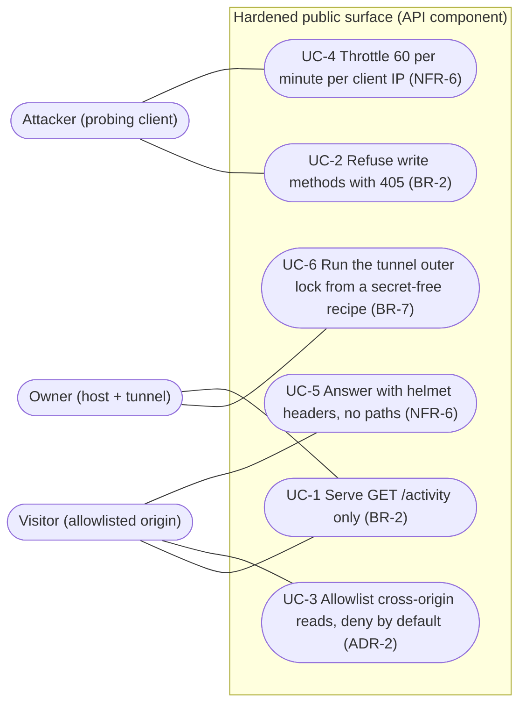
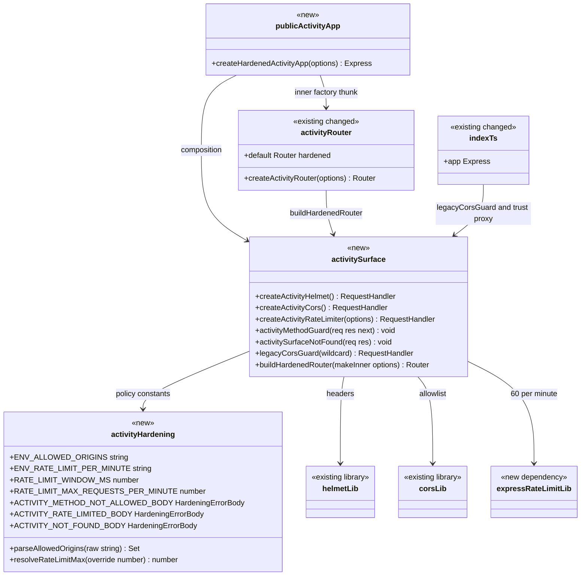
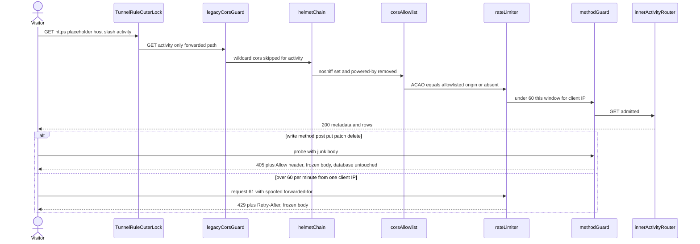
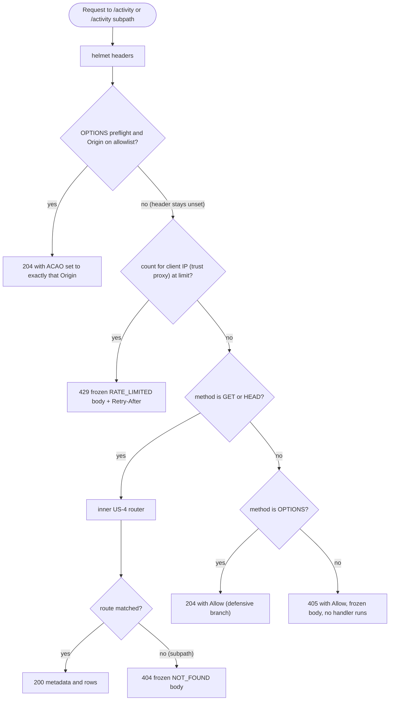
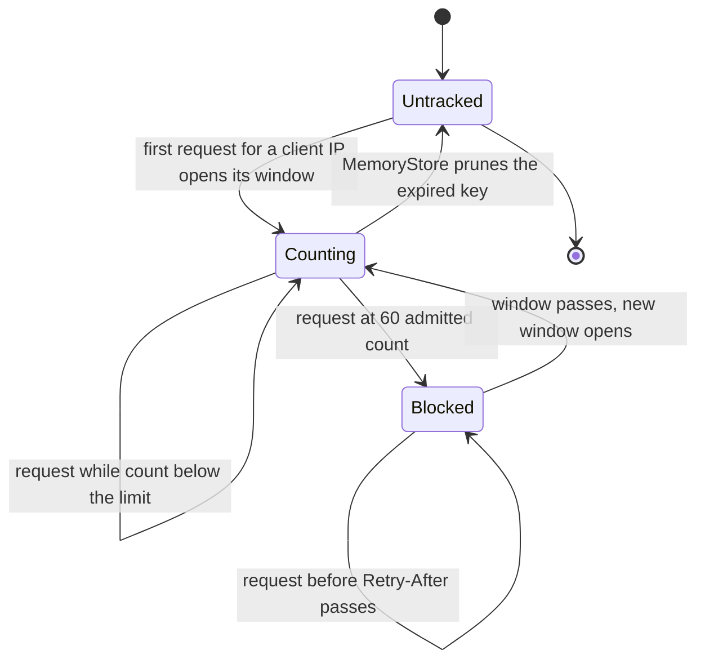

# Design: US-5 Public surface hardening

Status: draft

## Story and traceability

Story: US-5 (`docs/product/stories/US-5-public-surface-hardening.md`, Status: approved, Type: backend,
UX needed: no, Design needed: yes). Sprint: `docs/product/sprints/sprint-2.md` (Status: approved).

Component: the backend **API process** — the express application composed in `backend/src/index.ts`.
No CMP ID can be cited: `docs/architecture/architecture.md`, the requirements file and the ADR files are
**not tracked in this repository** (approved backlog Assumptions); the backlog is the working source of
truth, and it carries no Components table. This story adds **modules inside the existing API component**
plus a committed deployment **config artifact** the story itself mandates; it adds no component, no data
store and no inter-component dependency (see Deviations from architecture). Same precedent as
`docs/design/US-4-activity-api.md`.

| Cited by the story | What it constrains here | Source of the wording |
|---|---|---|
| BR-2 | The public surface is exactly `GET /activity`; nothing else is exposed | story AC-1/AC-2/AC-5 |
| BR-7 | No write access, no secrets, no real hostnames in anything committed or exposed | AC-5, AC-6 |
| NFR-6 | Hardened public surface: helmet, CORS allowlist, rate limit, trust proxy | AC-2, AC-3, AC-4 |
| ADR-2 | Defence in depth: the tunnel rule is the outer lock, method/CORS/rate-limit middleware the inner lock; both required | story Notes (ADR text untracked) |

Dependencies US-4 (`backend/src/activity/*`) and US-23 (`backend/src/import/modelNormalise.ts`) are
merged; this design wraps US-4's router, it does not modify its behaviour.

## Analysis

**Domain concepts and responsibilities**

- *Public activity surface*: the only path, method pair the internet may reach — `GET /activity`
  (plus the CORS `OPTIONS` preflight). Everything else under `/activity` and every other method must be
  refused *inside* the activity middleware chain, so the pre-existing wildcard `cors()` can never touch
  an activity response.
- *Inner lock vs outer lock* (ADR-2 per the story Notes): AC-1…AC-4 are the inner lock, provable in CI
  without a tunnel; the tunnel rule (AC-5) is the outer lock, a config artifact whose values live only on
  the owner's host.
- *Hermetic mount*: the hardened router answers **every** request whose path starts with `/activity`
  (200/204/404/405/429 — probes confirm a fall-through is impossible because the chain terminates on every
  branch). This is the load-bearing property for "the wildcard `*` never appears on any `/activity`
  response": the global wildcard `cors()` is never *reached* for those paths.
- *Coexistence with the legacy wildcard `cors()`*: the story explicitly leaves this to the tech lead
  (per-route middleware vs separate app/port). **Decision: per-route middleware inside the existing
  single app and port**, implemented as two symmetric pieces:
  1. a `legacyCorsGuard` shim replaces the bare `app.use(cors())` mount: it delegates every non-activity
     path untouched to the same wildcard `cors()` instance (legacy responses byte-identical — probe-
     verified `Access-Control-Allow-Origin: *` and `X-Powered-By: Express` persist on `/health`), and
     skips the wildcard entirely for `/activity` and `/activity/*`;
  2. the hardened activity router is the **default export of `src/activity/activityRouter.ts`**, so the
     `app.use('/activity', activityRouter)` mount line in `index.ts` stays **byte-identical**. The pre-
     existing US-4 structural test `tests/activityMount.test.ts` pins that line's text, its position
     (after the three legacy mounts) and the `from './activity/activityRouter'` import — remounting the
     surface elsewhere in `index.ts` would fail a test AC-7 forbids touching.
- *Why not a separate app/port*: a second listener is a runtime/deployment delta (new port to expose,
  US-13 packaging must learn it) and leaves an *unhardened* `/activity` twin on the legacy port — a
  second source of truth the owner could accidentally tunnel. The per-route design hardens the one
  existing mount in place; the tunnel still targets the single port. Rejected alternatives are recorded
  in the Patterns table.
- *Where the new modules live*: `backend/src/hardening/`, **not** `backend/src/activity/`. The merged
  pre-existing test `tests/activityReadOnly.test.ts` (AC-5(g)) pins `src/activity/*.ts` to an exact
  five-file list and forbids touching it (AC-7); new files in that directory would fail it. `src/hardening/`
  is unpinned and keeps the same structural scans (written by this story) honest.

**Existing code to reuse**

| Reused | How |
|---|---|
| `createActivityRouter(options)` — `src/activity/activityRouter.ts` (US-4) | Mounted as the inner router of the hardened chain, unchanged; the raw factory stays unhardened because US-4's contract and timing tests compose it directly (the timing suite fires 120 requests — a limiter baked into the factory would 429 it and break AC-7). |
| `tests/fixtures/activitySeed.ts` (US-4) | Seeds `activity.db` for the new tests through the importer's real write path; no literals retyped. |
| `helmet` 8.3.0, `cors` 2.8.6 (existing `package.json` dependencies) | Hardening middleware; zero new imports for headers and CORS. |
| `tests/activityReadOnly.test.ts` sidecar-assertion pattern | AC-1's "database unchanged" proof reuses the honest US-4 postconditions: main db byte-identical, `-wal` absent-or-0-bytes, `-shm` absent-or-32768-bytes. |
| Env save/restore convention from `tests/activityDb.test.ts` | New tests mutate `ACTIVITY_ALLOWED_ORIGINS` / `ACTIVITY_RATE_LIMIT_PER_MINUTE` per test and restore in `afterEach`. |
| `express-rate-limit` **new dependency** (story Notes delegate the choice to the tech lead) | `^8.7.5`, the ecosystem-standard express limiter; probe-verified against the merged stack. |

**Impact analysis (files and modules affected)**

| File | Change |
|---|---|
| `backend/src/hardening/activityHardening.ts` | **new** — pure policy: env-var names, constants, frozen bodies, allowlist/limit parsers. No express import. |
| `backend/src/hardening/activitySurface.ts` | **new** — the middleware chain factories and `buildHardenedRouter`. |
| `backend/src/hardening/publicActivityApp.ts` | **new** — `createHardenedActivityApp`, the index.ts-faithful composition for supertest tests. |
| `backend/src/activity/activityRouter.ts` | **edit (2 lines)**: default export `createActivityRouter()` → `buildHardenedRouter(() => createActivityRouter())`. `createActivityRouter` untouched. |
| `backend/src/index.ts` | **edit (3 lines)**: add `app.set('trust proxy', true);`; replace `app.use(cors());` with `app.use(legacyCorsGuard(cors()));`; add the `legacyCorsGuard` import. All other lines (health, json, legacy mounts, activity mount, listen) byte-identical. |
| `backend/package.json` | **edit**: add `express-rate-limit` to `dependencies` via `npm install --save express-rate-limit@^8.7.5` (authorised by the story Notes; this is the sanctioned exception to the "never touch dependencies" convention). |
| `backend/jest.config.js` | **additive**: `collectCoverageFrom` gains `'src/hardening/**/*.ts'`; thresholds `{ lines: 80 }` for the two new hardening modules. |
| `deploy/cloudflared/activity-tunnel.example.yml`, `deploy/cloudflared/README.md` | **new** at repo root — the committed tunnel artifact (AC-6), placeholders and env-var NAMES only. |
| New tests | `tests/fixtures/publicSurfaceFixtures.ts`, `tests/activityHardening.test.ts`, `tests/activitySurface.api.test.ts`, `tests/activitySurface.rateLimit.test.ts`, `tests/activitySurface.mount.test.ts`, `tests/tunnelConfig.test.ts` |
| Untouched (hard constraint) | `src/db.ts`, `src/routes/*`, `src/import/**`, `src/activity/{activityErrors,activityRepository,activityService,timeRange}.ts`, every pre-existing `*.test.ts` (AC-7), `tsconfig.json`, `src/middleware/concurrency.ts`. |

**Coupling and cohesion notes**

- Dependency direction is acyclic: `index.ts → activitySurface (legacyCorsGuard)`;
  `activityRouter → activitySurface (buildHardenedRouter)`; `publicActivityApp → activityRouter +
  activitySurface`; `activitySurface → activityHardening (pure)`; `activityHardening` imports nothing.
  `activitySurface` never imports `activityRouter` — the inner router arrives as a **factory thunk**
  (Strategy), which both breaks the potential cycle and is the test seam.
- The pure policy module (`activityHardening`) owns every number, env name and frozen string; the
  express-wiring module owns nothing but composition. Legacy routes never gain a dependency on the
  hardening code beyond the `legacyCorsGuard` pass-through at the cors mount.
- The US-4 scans of `src/activity/*.ts` (five pinned files) and the new scans of `src/hardening/*.ts`
  are disjoint; both run in CI.

**Risks**

| Risk | Handling |
|---|---|
| `app.set('trust proxy', true)` is trust-all: anyone connecting **directly** can spoof `X-Forwarded-For` and reset their limiter bucket | Accepted and required by AC-4's wording ("`trust proxy` enabled", spoofed-XFF burst test). The public entry point is the tunnel, which rewrites `X-Forwarded-For`; direct connections are LAN/localhost in the owner's deployment and the data is public read-only anyway. Recorded in Risks of the spec; `express-rate-limit`'s `PERMISSIVE_TRUST_PROXY` validation is explicitly disabled (probe: it throws otherwise) with the reason commented at the call site. |
| `trust proxy` also changes `req.ip` for the legacy `concurrencyLimit` (`src/middleware/concurrency.ts`, used by `POST /chat`) | Legacy behaviour "as tested" is unchanged: `tests/chat.test.ts` never sends `X-Forwarded-For`, so keys stay the peer address. Noted under Open questions for the architect — hardening did not choose to key chat on a spoofable header; a future story can pin `trust proxy` to the tunnel CIDR. |
| `POST /activity` bodies are parsed by the global `express.json()` (before the activity mount) up to its 100 kB default before the 405 | Accepted: parse-then-refuse; body is never read by any activity handler. Tightening the json limit is out of scope (US-4 mount test pins the line's presence; its position relative to activity is pinned after the legacy mounts). |
| `MemoryStore` grows one entry per distinct client key per window | v8 prunes expired windows periodically; entries are small counters. Portfolio-scale traffic is negligible; a pool behind one egress IP throttling at 60/min is already a listed sprint-2 risk (mitigation: raise `ACTIVITY_RATE_LIMIT_PER_MINUTE` — documented name, owner's value). |
| US-4 timing/contract suites break if hardening leaks into `createActivityRouter` | Hardening is baked only into the default export. `activitySurface.mount.test.ts` asserts behaviourally that the **raw** factory still answers without helmet headers (no `x-content-type-options`), pinning the separation. |
| cors 2.8.6 treats **every** `OPTIONS` as preflight and answers 204 before the method guard (probe) | AC-1 only requires `OPTIONS` "answered within the CORS policy" — satisfied (allowlist ACAO semantics apply; denied preflight falls through to the guard's 204 + `Allow`). The guard keeps a defensive `OPTIONS` branch for chain-order changes. |

## Use case

| Field | Content |
|---|---|
| Actor | Visitor (the public heatmap client on the owner's portfolio origin); Owner (site owner — runs the tunnel and the Manual (user) check); Attacker (anonymous client probing writes, foreign origins, throttling bypass) |
| Goal | Serve `GET /activity` to allowlisted origins and nothing else: no other method, no other path, no wildcard CORS, no unthrottled access, no secrets in committed config |
| Preconditions | Backend runs from `src/index.ts` with `ACTIVITY_DB_PATH` set (US-4 semantics); allowlist and rate-limit env vars per story config (allowlist unset ⇒ deny); on the owner's host, the tunnel runs from a private copy of the committed recipe |
| Main flow | 1. Visitor's browser (allowlisted origin) sends `GET /activity?from=&to=` through the tunnel. 2. The tunnel rule forwards only `/activity` to the backend (outer lock). 3. `legacyCorsGuard` skips the wildcard cors for the activity path. 4. helmet sets the security headers. 5. The CORS allowlist middleware sets `Access-Control-Allow-Origin` to exactly the request's `Origin`, or nothing. 6. The limiter admits the request (under 60 in the window for its `req.ip`, derived via trust proxy). 7. The method guard admits `GET`. 8. The US-4 inner router answers `200 {metadata, rows}`. |
| Alternative flows | A. `POST`/`PUT`/`PATCH`/`DELETE` `/activity` → guard answers `405` + `Allow: GET, OPTIONS` + frozen body; no DB handler runs (AC-1). B. `Origin` not on the allowlist (or allowlist unset, or absent) → no `Access-Control-Allow-Origin` on the response (AC-2). C. > 60 requests in the window for one client IP → `429` + frozen body + `Retry-After` (AC-4). D. `/activity/<anything>` → terminal guard answers `404` + frozen body, before the wildcard cors can answer (AC-2 hermeticity). E. Non-activity path (e.g. `/health`) → legacy chain unchanged: wildcard `ACAO: *`, `X-Powered-By: Express`, no helmet (AC-7). F. Non-activity path through the tunnel host → never forwarded; tunnel answers `404`/`403` (AC-5, Manual (user)). |
| Postconditions | `activity.db` byte-identical after every rejected write probe (US-4 sidecar postconditions hold); no committed file contains a real hostname, account name, token or cookie value (AC-6); all pre-existing tests pass unchanged (AC-7) |
| Acceptance criteria | AC-1 … AC-7 (AC-5 Manual (user); AC-6 reviewer-inspected + automated assist test) |



## Design

**Components and responsibilities (all inside the API component, new `src/hardening/` module group)**

| Module | Responsibility | Must never |
|---|---|---|
| `src/hardening/activityHardening.ts` | The single source of every hardening fact: env-var names, the 60/min and 60 s constants, CORS max-age, `Allow` value, frozen 405/429/404 bodies, `parseAllowedOrigins`, `resolveRateLimitMax`. Pure, imports nothing. | import express, read anything but `process.env`, log |
| `src/hardening/activitySurface.ts` | Chain factories: `createActivityHelmet`, `createActivityCors`, `createActivityRateLimiter`, `activityMethodGuard`, `activitySurfaceNotFound`, `legacyCorsGuard`, `buildHardenedRouter(makeInner, options)`. | import `activityRouter` (inner arrives as a thunk), contain policy numbers |
| `src/hardening/publicActivityApp.ts` | `createHardenedActivityApp(options)` — replicates the exact `index.ts` composition (trust proxy, guarded wildcard cors, json, hardened activity mount) for supertest fidelity tests. | call `listen`, import `src/db.ts` or legacy routes |
| `src/activity/activityRouter.ts` (edit) | Keeps `createActivityRouter` raw (US-4 contract/timing use it); default export becomes the hardened production router. | bake hardening into `createActivityRouter` |
| `src/index.ts` (edit) | Process composition: `trust proxy` on, wildcard cors behind `legacyCorsGuard`, single `/activity` mount (text unchanged). | mount `/activity` anywhere but after the legacy mounts (the pinned US-4 test) |

**Interfaces (name, inputs and types, output, errors)**

```ts
/* backend/src/hardening/activityHardening.ts — pure; imports nothing */
export const ENV_ALLOWED_ORIGINS: 'ACTIVITY_ALLOWED_ORIGINS';
export const ENV_RATE_LIMIT_PER_MINUTE: 'ACTIVITY_RATE_LIMIT_PER_MINUTE';
export const ACTIVITY_PATH: '/activity';
export const RATE_LIMIT_WINDOW_MS: 60_000;              // AC-4
export const RATE_LIMIT_MAX_REQUESTS_PER_MINUTE: 60;    // AC-4 (backlog figure)
export const CORS_MAX_AGE_SECONDS: 600;
export const ALLOW_HEADER_VALUE: 'GET, OPTIONS';

export interface HardeningErrorBody {
  readonly error: { readonly code: string; readonly message: string };
}
export const ACTIVITY_METHOD_NOT_ALLOWED_BODY: HardeningErrorBody;
// frozen: { error: { code: 'ACTIVITY_METHOD_NOT_ALLOWED', message: 'this endpoint only supports GET' } }
export const ACTIVITY_RATE_LIMITED_BODY: HardeningErrorBody;
// frozen: { error: { code: 'ACTIVITY_RATE_LIMITED', message: 'too many requests, try again shortly' } }
export const ACTIVITY_NOT_FOUND_BODY: HardeningErrorBody;
// frozen: { error: { code: 'ACTIVITY_NOT_FOUND', message: 'no such activity endpoint' } }

export function parseAllowedOrigins(raw: string | undefined | null): ReadonlySet<string>;
// undefined | null | '' | all-blank  =>  empty Set (deny by default).
// Otherwise: split on ',', trim each entry, drop empty entries, dedupe. Exact string match,
// NO case folding (probe: https://PORTFOLIO.example.com is denied against an allowlist holding
// the lowercase form). Values never hardcoded — they arrive only from env.

export function resolveRateLimitMax(override?: number): number;
// valid override (Number.isInteger && >= 1) => override            (test seam)
// else env ACTIVITY_RATE_LIMIT_PER_MINUTE, trimmed, /^\d+$/ && >= 1 => that value
// else RATE_LIMIT_MAX_REQUESTS_PER_MINUTE (60). '0', '-5', 'abc', '1e3', '60.5' all fall back to 60.

/* backend/src/hardening/activitySurface.ts */
import type { RequestHandler, Router, Express } from 'express';
import type { ActivityRateLimiterOptions } from './activitySurface'; // re-exported below

export function createActivityHelmet(): RequestHandler;
// helmet({ contentSecurityPolicy: false, crossOriginResourcePolicy: { policy: 'cross-origin' } })
// CSP off: a JSON-only API is never rendered as a document; AC-3's minimum (nosniff) plus XFO,
// HSTS, referrer-policy, dns-prefetch, download-options etc. stay on (probe-verified set).
// CORP 'cross-origin': the endpoint is deliberately readable from the allowlisted site origin.

export function createActivityCors(): RequestHandler;
// cors({
//   origin: (origin, cb) => cb(null, parseAllowedOrigins(process.env.ACTIVITY_ALLOWED_ORIGINS).has(origin)),
//   methods: ['GET'], allowedHeaders: [], maxAge: CORS_MAX_AGE_SECONDS,
// })  // preflightContinue: false (default) — cors answers the preflight itself; env read per request.

export interface ActivityRateLimiterOptions { readonly windowMs?: number; readonly max?: number }

export function createActivityRateLimiter(options?: ActivityRateLimiterOptions): RequestHandler;
// rateLimit({
//   windowMs: options?.windowMs ?? RATE_LIMIT_WINDOW_MS,
//   limit: () => resolveRateLimitMax(options?.max),        // env re-read per request
//   standardHeaders: 'draft-7', legacyHeaders: false,      // RateLimit + RateLimit-Policy + Retry-After
//   validate: { trustProxy: false },                       // story mandates trust proxy true (AC-4)
//   handler: (_req, res) => res.status(429).json(ACTIVITY_RATE_LIMITED_BODY),
// })  // default keyGenerator (req.ip) — keys on the proxied client IP via app.set('trust proxy', true)

export function activityMethodGuard(req: Request, res: Response, next: NextFunction): void;
// 'GET' | 'HEAD' => next() (the inner router's route serves HEAD as express does for GET)
// 'OPTIONS'      => res.set('Allow', ALLOW_HEADER_VALUE).status(204).end()   // defensive: cors 2.8.6
//                   answers every OPTIONS as preflight first, so this branch only fires on order changes
// otherwise      => res.set('Allow', ALLOW_HEADER_VALUE).status(405).json(ACTIVITY_METHOD_NOT_ALLOWED_BODY)

export function activitySurfaceNotFound(req: Request, res: Response): void;
// res.status(404).json(ACTIVITY_NOT_FOUND_BODY)  // terminal: /activity/<anything> never escapes the chain

export function legacyCorsGuard(wildcard: RequestHandler): RequestHandler;
// (req, res, next) => (req.path === ACTIVITY_PATH || req.path.startsWith(ACTIVITY_PATH + '/'))
//     ? next() : wildcard(req, res, next)

export type ActivityInnerFactory = () => Router;
export interface HardenedRouterOptions { readonly dbPath?: string; readonly rateLimit?: ActivityRateLimiterOptions }
export function buildHardenedRouter(makeInner: ActivityInnerFactory, options?: HardenedRouterOptions): Router;
// order: createActivityHelmet() -> createActivityCors() -> createActivityRateLimiter(options?.rateLimit)
//        -> activityMethodGuard -> r.use('/', makeInner()) -> activitySurfaceNotFound
// makeInner is called once at construction; never invoked before construction completes.

/* backend/src/hardening/publicActivityApp.ts */
export interface HardenedAppOptions { readonly dbPath?: string; readonly rateLimit?: ActivityRateLimiterOptions }
export function createHardenedActivityApp(options?: HardenedAppOptions): Express;
// const app = express();
// app.set('trust proxy', true);
// app.use(legacyCorsGuard(cors()));                       // the legacy wildcard, active for non-activity only
// app.use(express.json());
// app.use('/activity', buildHardenedRouter(
//   () => createActivityRouter({ dbPath: options?.dbPath }), { rateLimit: options?.rateLimit }));
// return app;                                             // never calls listen, never opens the legacy DB

/* backend/src/activity/activityRouter.ts — the two-line edit (everything above untouched) */
import { buildHardenedRouter } from '../hardening/activitySurface';
export default buildHardenedRouter(() => createActivityRouter());  // was: export default createActivityRouter();

/* backend/src/index.ts — the three-line edit (all other lines byte-identical) */
import { legacyCorsGuard } from './hardening/activitySurface';
const app = express();
app.set('trust proxy', true);              // AC-4: req.ip = client IP behind the tunnel proxy
app.use(legacyCorsGuard(cors()));          // was: app.use(cors());  — identical treatment for legacy paths
```

**Request adjudication (normative order)** — every `/activity*` request answers at the first row whose
condition matches; none can reach `express.json`-mounted legacy middleware or the wildcard cors:

| # | Check | Outcome |
|---|---|---|
| 1 | helmet headers set (all responses) | continue |
| 2 | `OPTIONS` (any) and `Origin` on allowlist → preflight admit | `204` + ACAO=origin + `Access-Control-Allow-Methods: GET` + max-age 600 |
| 3 | `Origin` off allowlist / absent / allowlist unset | ACAO never set; continue |
| 4 | limiter: count for `req.ip` (trust-proxy-derived) already ≥ resolved limit in the current window | `429` + frozen `ACTIVITY_RATE_LIMITED_BODY` + `Retry-After` |
| 5 | method is `GET`/`HEAD` | continue to inner router → `200` (US-4 semantics) |
| 6 | method is `OPTIONS` (fell through 2/3) | `204` + `Allow` |
| 7 | any other method | `405` + `Allow` + frozen `ACTIVITY_METHOD_NOT_ALLOWED_BODY` |
| 8 | inner router did not match (subpath) | `404` + frozen `ACTIVITY_NOT_FOUND_BODY` |

## Patterns

| Pattern | Problem it solves here | Where applied | Alternatives considered | Consequences |
|---|---|---|---|---|
| Chain of responsibility (ordered middleware pipeline — the express idiom) | The five inner locks must run in one exact order on one path prefix and nothing else | `buildHardenedRouter` (helmet → cors → limiter → guard → inner → terminal) | Bake hardening into `createActivityRouter` (rejected: US-4's timing suite fires 120 requests through that factory and would hit 429 — breaks AC-7); separate app/port (rejected: deployment/runtime delta, unhardened `/activity` twin on the legacy port, and the pinned mount-line test punishes remounting in `index.ts`) | One place defines the public surface; the mount line in `index.ts` stays byte-identical |
| Guard (defensive termination) | Hermeticity: no `/activity*` response may fall through to the wildcard cors (AC-2 "wildcard never appears") | `activityMethodGuard` (405/204) + `activitySurfaceNotFound` (404) | Let express fall through and "clean up" headers afterwards (rejected: cors preflights short-circuit *before* any later middleware could remove their headers — probe-confirmed) | Every branch answers inside the chain; probes confirm no reachable fall-through |
| Strategy (inner-router factory injection) | `activitySurface` must not import `activityRouter` (cycle) and tests must bind a scratch DB | `buildHardenedRouter(makeInner, { dbPath })`; `publicActivityApp` and the `activityRouter` default export supply different thunks | Direct import of the router module (rejected: import cycle — `activityRouter` must import the builder to expose the hardened default export); `require` inside handlers (rejected: hidden dependency) | One seam, two productions (production unbound/env-driven, test dbPath-bound) |
| Decorator (transparent wrapper around the legacy wildcard) | Legacy CORS behaviour must be preserved exactly (AC-7) while one path prefix opts out | `legacyCorsGuard(cors())` in `index.ts` | Delete the wildcard mount (rejected: legacy routes lose their tested ACAO behaviour); per-route cors on each legacy route (rejected: touches files out of scope) | Legacy responses byte-identical (probe: `/health` keeps `ACAO: *` + `X-Powered-By: Express`); activity opted out |
| Constant (frozen) bodies + policy constants | NFR-5/BR-1 discipline: no interpolated, path-bearing or value-leaking error text; single source for every number/name | `activityHardening.ts` (`Object.freeze`d bodies, env-name and limit constants) | Inline literals per middleware (rejected: US-16 must retune by env name; scans and tests need single sources) | 405/429/404 bodies are one byte-string each, asserted byte-identical in tests |
| Deny-by-default allowlist (Null Object for "no config") | AC-2: unset allowlist must mean deny, never wildcard | `parseAllowedOrigins` returns an empty Set ⇒ cors origin callback always false | Default to `*` when unset (rejected outright: breaks AC-2 and ADR-2); fail the app at boot without an allowlist (rejected: the app must boot for local dev and the whole US-4 suite; deny silently satisfies the criteria) | A mis-set/absent allowlist fails closed — the heatmap shows nothing until the owner sets origins (US-16) |
| Fixed-window counting (per key, library-provided) | AC-4's 60/min with `Retry-After` and no homegrown timing bugs | `express-rate-limit` MemoryStore; window = `windowMs` for a client-IP key, first request in the window opens it (probe-verified v8.7.5 behaviour) | Sliding window (`rate-limiter-flexible` — rejected: heavier dep and state for a public read-only endpoint; worst-case ~2×60 across a window edge is acceptable, sprint-2 risk already lists 60/min as a starting value); hand-rolled limiter (rejected: reinventing a security-proven wheel, US-4 precedent avoids new non-essential code) | Window rounding: no wall-clock anchoring — the window belongs to the key, not the minute; recovery asserted by sleeping past `Retry-After` (probe-stable recipe), never by assuming epoch alignment |
| Config artifact with placeholders (committed recipe) | AC-5/AC-6: deployment recipe committed without secrets or real hostnames | `deploy/cloudflared/activity-tunnel.example.yml` + README; `${ENV_NAME}` placeholders, RFC 2606 hostnames | Committing a filled config (rejected: BR-7); documenting the tunnel only in chat/PR text (rejected: AC-6 demands a committed artifact) | Reviewable in CI by `tests/tunnelConfig.test.ts`; owner fills values on the host only |

## Diagrams









## Data model

**Schema delta: none.** The story reads nothing and writes nothing: `activity.db` is opened solely by
the US-4 inner router via `openActivityDb({ readonly: true })`, and every refused request (405/429/404)
never reaches a DB connection at all. AC-1's database-unchanged assertion therefore uses the US-4-
approved postconditions (main file byte-identical; `-wal` absent-or-0 bytes; `-shm` absent-or-32768
bytes). No new tables, columns, indexes or migrations; no config is stored in the database — hardening
config lives in environment variables and the committed tunnel recipe only.

## Error handling and edge cases

| Case | Behaviour (design) | AC |
|---|---|---|
| `POST`/`PUT`/`PATCH`/`DELETE` `/activity` (any body, any origin) | `405`, `Allow: GET, OPTIONS`, frozen body; `usage_event` bytes/rows unchanged | AC-1 |
| `GET /activity` | `200` US-4 semantics unchanged (including its 200-empty and 400 contract) | AC-1/AC-7 |
| `OPTIONS /activity` (preflight or bare) | `204`; ACAO = exact allowlisted origin or absent; `Access-Control-Allow-Methods: GET`; max-age 600 | AC-1/AC-2 |
| `Origin` denied / absent / allowlist unset / entry only-differs-in-case | No `Access-Control-Allow-Origin` (deny by default, exact match) | AC-2 |
| `/activity/anything` (subpath) | `404` frozen body, never falls through to the wildcard cors | AC-2 |
| `/activityfoo` (different segment) | Not part of the surface; legacy chain behaviour (wildcard cors applies) | AC-7 |
| > 60 requests in the window from one client IP (via `X-Forwarded-For` under trust proxy) | `429` frozen body + `Retry-After` (1…window seconds) + draft-7 `RateLimit` header; other IPs and the no-XFF peer unaffected | AC-4 |
| `ACTIVITY_RATE_LIMIT_PER_MINUTE` garbage (`0`, `-5`, `abc`, `1e3`) | Falls back to the 60 default (never disables the limiter) | AC-4 |
| Direct (non-tunnel) attacker spoofing `X-Forwarded-For` to escape the limit | Possible by design (trust-all); accepted — the tunnel rewrites the header and is the public entry (Risks) | AC-4 |
| Express default header | `X-Powered-By: Express` set once in `app.handle`; helmet's chain removes it for `/activity` only; legacy keeps it | AC-3/AC-7 |
| Response header/body carrying a filesystem path or DB file name | Structurally impossible: bodies are frozen constants; the US-4 router never echoes paths; tests scan headers and bodies for the scratch `dbPath`, `activity.db`, `node_modules` and `tmp`-rooted paths | AC-3 |
| Legacy route response (e.g. `GET /health`) | Byte-identical to today: wildcard `ACAO: *`, `X-Powered-By: Express`, no helmet headers | AC-7 |
| Non-activity path requested on the tunnel hostname | Never reaches the backend: tunnel `404`/`403` (also `/activity/entity` arrives as `/activity/activity/entity` and dies at the tunnel rule or, if it ever arrived, the inner 404 guard) | AC-5 (Manual) |

## Security and privacy

- Inner lock (this story, CI-proven): method lock (405), CORS allowlist (deny-by-default, no wildcard,
  exact-origin), helmet (`X-Content-Type-Options: nosniff` minimum; CSP off for a JSON-only API —
  recorded under Open questions), fixed-window 60/min per proxied client IP, terminal 404 hermeticity.
- Outer lock (owner-run, AC-5): the committed tunnel recipe forwards **only** `/activity`
  (`service: http://127.0.0.1:8080/activity`) with an `http_status:404` catch-all; TLS is the tunnel
  service's (story Out of scope).
- Secrets policy (BR-7, AC-6): committed artifacts contain `${ENV_NAME}` placeholders and RFC 2606
  hostnames (`activity.example.com`) only; values exist solely on the owner's host; the filled config is
  never committed (README states it, `tests/tunnelConfig.test.ts` enforces the patterns, plus the
  spec-mandated secrets-pattern scan of the diff).
- Test data: `https://portfolio.example.com`, `https://api.example.com` (allowed),
  `https://notallowed.example.com` (denied); client IPs `203.0.113.7`, `203.0.113.8`, proxy
  `198.51.100.9` — all RFC 5737 / RFC 2606 documentation ranges. No real personal data, tokens,
  cookies, hostnames or prompt/response marker text anywhere.
- No authentication added (story Out of scope); the surface is public read-only by construction.

## Test strategy

- **Unit (pure, no express)** — `tests/activityHardening.test.ts`: `parseAllowedOrigins` truth table
  (undefined/null/''/blank-only → empty set; comma list with spaces and empties → trimmed set; dedupe;
  no case folding); `resolveRateLimitMax` (override precedence, env `'90'→90`, `'0'/'-5'/'abc'/'1e3'/
  '60.5'→60, override wins over env); frozen bodies are `Object.isFrozen`, same object identity
  (`toBe`), `Allow`/window/limit constants pinned. Serves AC-2/AC-4 halves.
- **Contract (Jest + supertest over `createHardenedActivityApp`, seeded via the US-4
  `seedActivityDb`, composed exactly like the edited `index.ts`)** —
  `tests/activitySurface.api.test.ts`: AC-1 one `it` per write method (405 + Allow + frozen-body
  byte-equality + database-unchanged assertion) + `GET` 200 + `OPTIONS` 204-in-CORS-policy; AC-2 the
  three pinned origins (allowed/denied/absent) + deny-by-default with env unset + the no-wildcard sweep
  over every status response class captured in the suite; AC-3 helmet header assertions (`nosniff`
  present, `x-powered-by` undefined, XFO/referrer-policy/HSTS present) + header/body path-and-dbname
  scan incl. the scratch `dbPath` string.
- **Rate limit (Jest + supertest)** — `tests/activitySurface.rateLimit.test.ts`: constants 60/60_000;
  the 62-request spoofed-`X-Forwarded-For` burst on a fresh app (`#61`/`#62` → 429, first 60 captured as
  200s, `Retry-After` ∈ 1…60, draft-7 `RateLimit` header); key-independence (second RFC 5737 IP and the
  no-XFF peer still 200 during exhaustion; two-hop XFF chain keys on the leftmost address); window
  recovery via the probe-stable sleep-past-`Retry-After` recipe on a `{ windowMs: 1000, max: 5 }`
  instance; env-override instance (`ACTIVITY_RATE_LIMIT_PER_MINUTE=3`).
- **Structural/behavioural mount proof** — `tests/activitySurface.mount.test.ts`: `src/index.ts` text
  contains `app.set('trust proxy'`, `legacyCorsGuard(cors())`, exactly one `app.use('/activity'` still
  after the three legacy mounts (re-pins the US-4 invariants); behavioural: the hardened **default
  export** of `activityRouter` answers 405 + nosniff when mounted like `index.ts`, while the **raw**
  `createActivityRouter` factory still answers with **no** helmet headers (pins US-4 timing-suite
  immunity); `src/hardening/*.ts` scan for `__dirname`, `'../db'`, better-sqlite3 value imports,
  `console.` (hardening code is silent — NFR-5).
- **Tunnel artifact (automated assist for the AC-6 review)** — `tests/tunnelConfig.test.ts`: reads the
  two committed artifacts; asserts the yml names `/activity` as the only forwarded `service` path
  (single occurrence), has the `http_status:404` catch-all, every hostname/URL token is a `${...}`
  placeholder or RFC 2606/localhost, credentials-file is placeholder-only, no `NAME=value` assignment of
  the documented env vars appears, no credential-shaped token matches, and the README documents the
  five env-var **names**.
- **AC-5 — Manual (user)** on the owner's host (the container cannot see the tunnel): run the tunnel
  from a private copy of the recipe and report **status codes only** for `/activity` (expect 200) and
  `/entity`, `/chat`, `/health` (expect 404/403 each).
- **AC-7** — full `npm test` green on the branch (all pre-existing suites unchanged), plus
  `git diff origin/main...HEAD -- backend/tests | grep -c '^-[^-]'` → `0`, `npx tsc --noEmit`,
  `npm run lint`.
- Every acceptance criterion is served by at least one named task; the mapping table lives in the spec's
  Test plan.

## Deviations from architecture

none observable (the architecture file, requirements and ADRs are untracked — backlog Assumptions; same
note as the US-4 design). Items recorded for the architect/owner rather than resolved here, none
blocking this story:

- **New dependency** `express-rate-limit` inside the existing API component. The story Notes explicitly
  delegate the limiter library choice to the tech lead ("record it in the design"); no new component,
  data store or inter-component dependency is added. Listed so the architect sees the stack addition.
- **`trust proxy: true` is process-wide**, which also makes the legacy `concurrencyLimit` key on a
  spoofable header (Risks). The architecture text is untracked, so whether per-component proxy trust is
  an architectural decision could not be checked; raised as an open question.
- The tunnel config artifact under `deploy/` is a committed **file**, not a diagram: no component or
  deployment diagram is drawn or edited here (ownership rules respected); the artifact is the story's
  own AC-6 requirement.

## Open questions

- ADR-2/NFR-6 texts are untracked in this repo; the design works from the approved story Notes'
  paraphrase ("public surface is exactly `GET /activity`", "60/min", "helmet/trust-proxy requirements
  come from the backlog line"). The owner/architect confirm the wording at the sprint exit (same gap
  the US-4 design recorded).
- helmet CSP is disabled for the JSON-only activity endpoint (AC-3 pins `nosniff` as the minimum). If
  the owner later serves anything HTML-rendered from this router, re-enabling CSP is a one-line change —
  confirm acceptable at review.
- Process-wide `trust proxy` also affects `concurrencyLimit` on `POST /chat` (untested behaviour
  unchanged, but a spoofable key). Should a later story pin trust to the tunnel's CIDR instead of `true`?
  Not decidable here (AC-4 literally requires trust proxy enabled + spoofed-XFF test).
- AC-5's "404 or 403 from the tunnel rule": the committed recipe implements the 404 variant
  (`http_status:404` catch-all); a Cloudflare WAF/policy 403 variant is owner choice — the manual check
  accepts either (story wording).
- Diagram validity: diagrams follow `templates/diagrams.md` syntax exactly but Mermaid is not installed
  in this container — hand-checked, not machine-parsed. If a renderer errors, correct syntax only; the
  normative behaviour is the text and signatures above.

## Change log

| Change | Reason |
|---|---|
| Initial version | US-5 `Design needed: yes`; produced from the approved story, sprint-2 exit conditions, backlog Assumptions, the merged US-4/US-23 specs and probe-verified runtime facts (express-rate-limit 8.7.5 via `--no-save`, helmet 8.3.0, cors 2.8.6, express 5.3.0, Node 22) |
